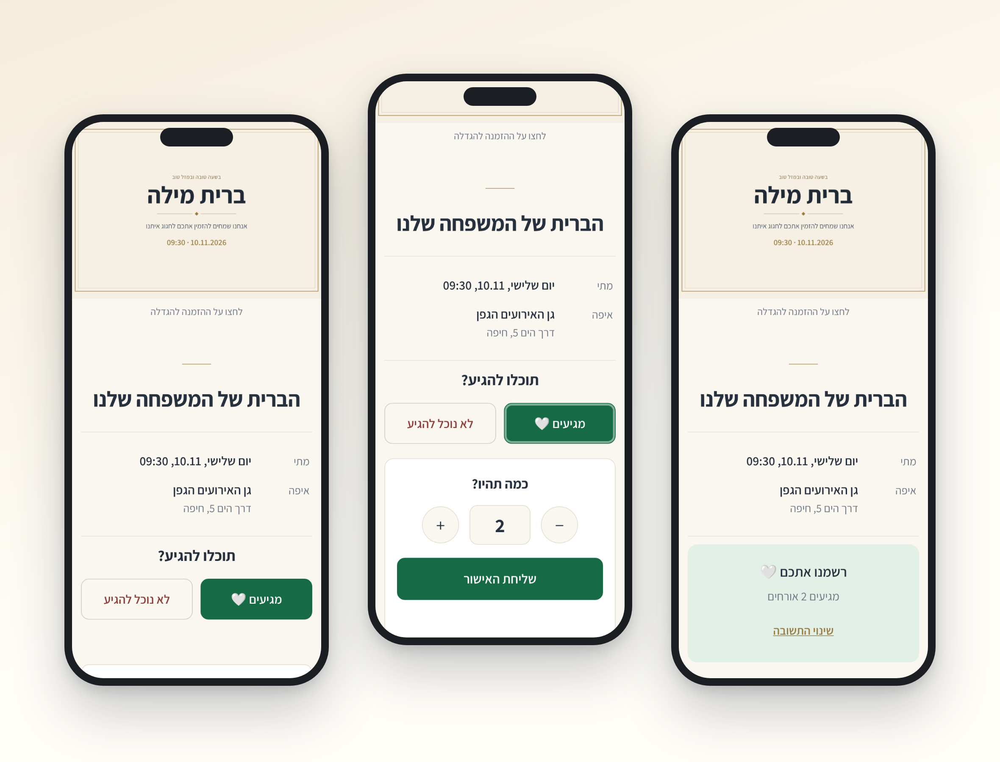
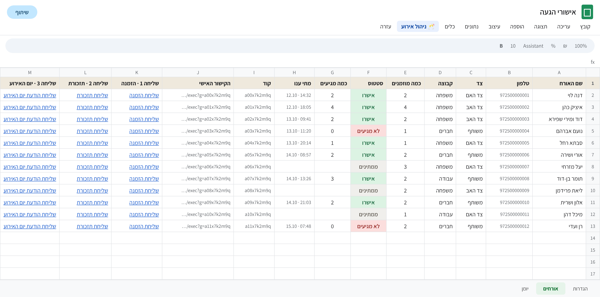
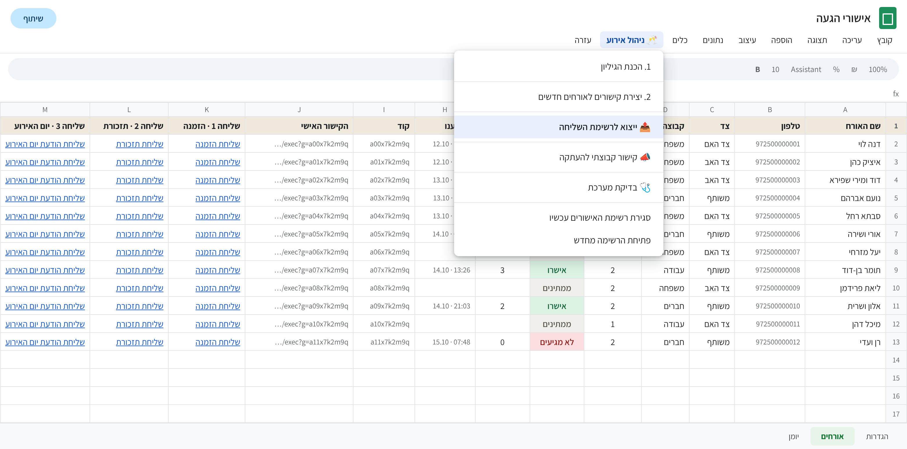
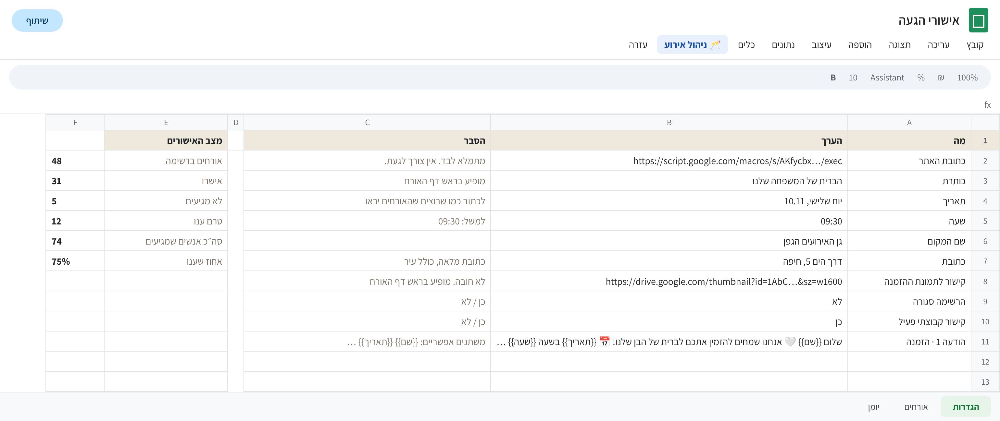
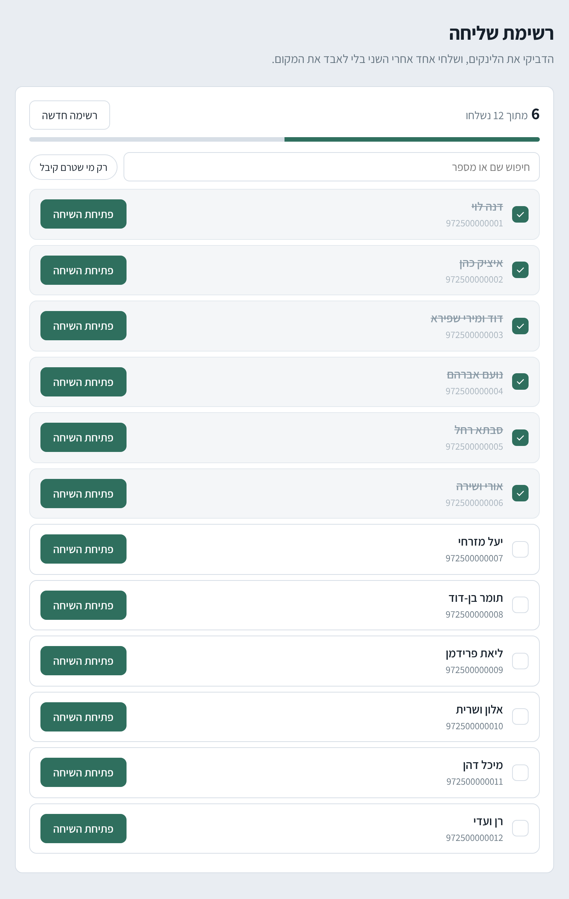
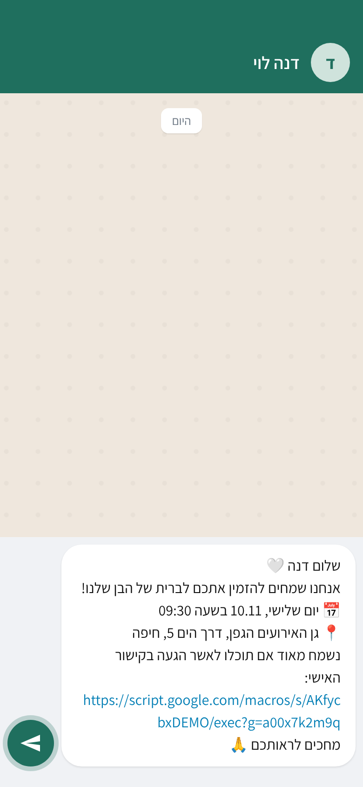

# מגיעים · מערכת אישורי הגעה לאירועים

> ## ⚠️ דף הצגה בלבד · Showcase only
> **מאגר זה מציג את הפרויקט ואינו כולל קוד.** קוד המקור, דפי האורח והמדריכים של המערכת הם קניין רוחני של היוצרת, ומוחזקים במאגר פרטי.
> אם את/ה מעסיק/ה או מגייס/ת ורוצה/ה לעיין בקוד, אשמח לשתף אותו בהרשאת קריאה בלבד. אפשר ליצור איתי קשר ואוסיף אותך כ-Collaborator.
>
> **This repository is a showcase only and contains no source code.** The source code is proprietary and kept in a private repository. If you are a recruiter or hiring manager and would like to review it, please contact me and I will add you as a read-only collaborator.
>
> 📬 **ליצירת קשר:** [LinkedIn](https://www.linkedin.com/in/inbal-pessah/) · [inbalps12@gmail.com](mailto:inbalps12@gmail.com)

---

## מה זה?

מערכת קטנה שמאפשרת לשלוח לכל אורח באירוע **קישור אישי**, והוא מאשר הגעה בשתי לחיצות מהטלפון. התשובות נכנסות בזמן אמת לגיליון של המארגנת, והיא רואה בדיוק כמה אנשים מגיעים.

המוצר נמכר ללקוחות פרטיים כערכה להתקנה עצמית, עם מדריכי הקמה ורישיון שימוש.

## הרעיון המרכזי

רוב מערכות ה-RSVP בנויות כאפליקציה: שרת, מסד נתונים, חשבון ומנוי. כאן ויתרתי על כל השכבות האלה. **כל המערכת רצה בתוך קובץ Google Sheets אחד של הלקוחה**, בלי שרת, בלי עלות ובלי תלות בספק חיצוני.

אירוע חד-פעמי לא מצדיק תשתית. הוא מצדיק כלי שמוקם בכרבע שעה ובלי ידע טכני.

## מה בפנים

- **קישור אישי לכל אורח**, עם טוקן בן 10 תווים. הסרתי מהאלפבית תווים מבלבלים כמו `0`, `O`, `1`, `l`, `i`.
- **דף אורח בעברית (RTL)**, מותאם לטלפון, עם אישור הגעה, מספר מגיעים וקישורי ניווט לאירוע.
- **גיליון ניהול**: לשונית הגדרות עם דשבורד, לשונית אורחים ולשונית יומן שינויים.
- **רשימת שליחה** שמכינה הודעות מוכנות לשליחה בוואטסאפ עם הקישור האישי.
- **הצטרפות דרך קישור קבוצתי** לאירועים שבהם אין רשימת מוזמנים סגורה.
- **נעילת אישורים** אחרי תאריך סגירה, ובדיקת תקינות (health check) של ההגדרות.
- **יומן שינויים** שמתעד כל שינוי סטטוס עם הערך הקודם והחדש, כדי לשחזר מצב אחרי דריסה בטעות.

## ארכיטקטורה (בקצרה)

```
Google Sheets  (הקובץ של הלקוחה)
   ├─ הגדרות · אורחים · יומן
   │
Google Apps Script  (container-bound)
   ├─ לוגיקה, ולידציה ו-API
   └─ דף אורח (HTML)
   │
Web App  ← גישה ציבורית, בלי התחברות
```

## החלטות שאני גאה בהן

- **אבטחה לפי כתובת בלתי ניתנת לניחוש, במכוון ובלי סיסמאות.** אורח בן שמונים לא יעבור תהליך הזדהות. מרחב הטוקנים הוא כ-820 טריליון צירופים, והסיכון האמיתי הוא העברת קישור ולא ניחוש. לכן הדף מציג את שם האורח, והיומן שומר היסטוריה.
- **ויתור מודע על מסד נתונים.** זה היתרון העסקי של המוצר וגם הגבול הטכני שלו, ותיעדתי את שניהם במסמך טכני.
- **תיעוד כחלק מהמוצר.** מדריך הקמה בעברית לא-טכנית, מילון מסכים עברית-אנגלית, מדריך פתרון תקלות ומסמך טכני.
- **מודל רישוי** שמגן על הקוד ומאפשר ללקוחה להשתמש במערכת כמה אירועים שתרצה.

## טכנולוגיות

Google Apps Script (JavaScript) · Google Sheets · HTML/CSS · Web App deployment · עיצוב RTL ו-mobile-first

## צילומי מסך

כל הנתונים בצילומים הם דוגמה: שמות, טלפונים וכתובות בדויים.

**חוויית האורח בטלפון:** הזמנה, בחירת כמות מגיעים ואישור.



**גיליון הניהול:** רשימת האורחים עם סטטוסים בזמן אמת, ותפריט "ניהול אירוע" בתוך Google Sheets.




**הגדרות ודשבורד:** כל הגדרות האירוע ונתוני התשובות במקום אחד.



**רשימת שליחה והודעה אישית:** שליחת הקישור לכל אורח בוואטסאפ, אחד אחרי השני, בלי לאבד את המקום.




## התפקיד שלי

יצרתי את המוצר מקצה לקצה: הגדרת הרעיון והמוצר, תכנון הארכיטקטורה, פיתוח המערכת (Google Apps Script ודף האורח), עיצוב חוויית האורח, כתיבת מדריכי ההקמה והמסמך הטכני, ניסוח הרישיון ומכירה ללקוחות.

## הצעד הבא

אני בונה שרת רישוי לניהול הרישיונות. הגרסה הנוכחית מתועדת כאן כנקודת התחלה.
